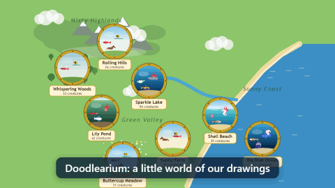

# 🐠 Doodlearium

A family digital aquarium where everything in it was drawn by the family. It runs on an always-on computer at home. Put it on the TV, and draw new creatures from any phone, tablet or PC on the home network.



It's a little world of places: 🏞️ **Sparkle Lake** (the original tank), 🪷 **Lily Pond**, 🌊 **Big Blue Ocean** and 🏖️ **Shell Beach** underwater, and 🌼 **Buttercup Meadow**, 🚜 **Sunny Farm**, ⛰️ **Rolling Hills** and 🌲 **Whispering Woods** up on land. The world lives on the server: every screen showing a place shows the same fish in the same spots doing the same things, and life carries on everywhere while nobody's watching (and across restarts). Everything notable is written into a **history**, which can be turned into stories.

**Every drawing is a kind of creature** (a species). The one that was drawn keeps its name and lives in one place; the world adds more of its kind wherever they suit, called "a Clowny", so one drawing of a weed can carpet a whole pond and one fish can be a whole school. See **Who lives where** below.

## Running it

```bash
npm install
npm start          # builds the client and serves everything on http://localhost:3000
```

The server prints its address on your network, for example `http://192.168.1.20:3000`. Open that address on other devices.

`npm start` keeps it running: if the server stops unexpectedly it starts again, and the ⚙️ menu's **🔄 Check for updates** can update it (see **Updating** below). Stop it with Ctrl+C.

| Page | What it's for |
| --- | --- |
| `/tank/` | The aquarium. It opens on a storybook **map** of the world, with a brass porthole for each place showing a few of the creatures that live there (places that aren't open yet are greyed out, "coming soon"). Tap a porthole and the screen dives through it into that place; **🗺️ Map** (or M, or pinching out) zooms back out. Each screen comes back to the place it showed last; `/tank/?place=pond` always opens the Pond, handy for a TV bookmark. When there's more than one world (see **Worlds** below), a strip of them along the bottom of the map travels to another one: a rocket swooshes across the stars and the new world's map grows in. `/tank/?world=…` opens a world's map. Double-click for full screen; click to drop food. Move the mouse (or tap) and buttons appear: **✏️ Draw**, **🖼️ Gallery** and **📖 History** to get around, **⚙️** for the tank controls (see below) and **🔇/🔊** (or the S key) for soft sounds. They hide again, with the cursor, when left alone. A **Coming up** card under the buttons lists what's about to happen anywhere in the world (the next visitor, egg hatching, explorer's arrival or planned event, and where; tap one to go there); it stays on screen by itself in the last couple of minutes, so you know to gather round the TV. Point at a creature (or tap it) to see its name, who drew it and what it's like (or, for one of a kind, how many there are in the world). The tank dims at night. The whole tank fits on any screen; a screen of a different shape sees more water above or sand below (a tall phone zooms in a little). See **Life in the tank** below for what goes on. |
| `/draw/` | Two steps. **Drawing:** tools sit in a rail on the left (keys **B** brush, **E** eraser, **F** fill, **X** extras, **S** select), the paper fits the screen in the middle, and the panel on the right shows only the chosen tool's options (size always at the top, then colour, paint and patterns; **[** and **]** change the size). **What is it? ▾** at the top left says how it moves (see **Motion styles** below), and the top bar has Undo (**Ctrl+Z**), Mirror, Facing, Clear, Preview and Photo. **Ready ➜** goes to the second step, where it swims about in a preview while you name it and choose where it lives, then **Add to the world** (or **← Back to drawing**). On a phone the tools go under the paper and the options below them. It drops in live, and the page says which place it moved into. **▶ Preview** shows it moving in a little tank while you draw (on a wide screen beside the options, on a tall one under the paper) (tap the preview to feed it). Tools: brush (with rainbow paint, and **invisible** paint that makes see-through holes, shown as a checkerboard), eraser, a **fill** bucket with materials (brick, stone, wood, bark, scales, feathers, fur, hair, wool, patches, stripes, dots, rainbow; **Turn** points scales, feathers and fur up, down, left or right, and runs wood, bark, brick, hair, stripes and rainbow across or up and down), **💡 Glow paint** (glows softly, brightest at night) and **🟣 Blacklight paint** (looks ordinary until the tank's blacklight goes on) for the brush and fill, **mirror** drawing, **⬚ Select** (paint over a part, or draw a loop around it, then drag it to move it, or make it bigger, smaller, turned, flipped, copied or deleted; extras on it come along), and **extras**. Extras are animated things pinned to a drawing: bubbles, sparkles, a glow, a googly eye, a waving flag and a propeller. The preview's **🟣 Blacklight** button shows blacklight paint glowing. **📷 Photo** turns a photo of a paper drawing into a drawing, removing the paper. You can also **paste** a picture (Ctrl+V, say after a Windows + Shift + S screenshot): on an empty page it's used like a photo, and on a drawing it lands on top, selected, ready to move and resize. A plain background around a pasted picture is cleared. **🌙 Night creature** (under What is it?) makes it only come out after dark. **🧭 Explorer** (for animals) makes it an explorer: one of a kind, travelling from place to place (see **Explorers** below). **Worlds** (when there's more than one) picks which worlds it lives in: ticked are where it lives now (its drawing packs' worlds, or Earth), and changing them makes them its own choice. **Lives in** picks the kinds of place it suits (each style starts with its usual ones, see below), **🐟🐟 Comes in a group** (under What is it?) makes more of it turn up together as a school, **Size** (small, medium or big) sets roughly how big its kind grows (each one still comes out a little different; on land a small plant is a little wildflower in the grass, a medium one a tall flower or a bush about as tall as a horse, and a big one a tree), **🏠** can put the one you drew in a particular place, and **📍 Choose places…** opens each of its worlds' maps to tap exactly which places it lives at (faded places don't suit its style; with none picked, it lives anywhere in its worlds that suits it). The preview shows it in the first place picked. The drawing so far is kept in the browser as you go, so a closed tab (or a crash) doesn't lose it: opening the draw page again brings it back (moving parts come back as plain drawing), until it's added to the world or **🗑 Clear** starts a new one. |
| `/gallery/` | Every drawing ever made, babies included (**🐣 Babies** shows just those), with where its kind lives and how many (🏠 marks where the original is). **Edit** opens one in the draw page, for example to fix a fish that swims backwards. **📄 Copy** makes a copy of your own (it asks for a name, joins the world too, and belongs to no pack, so pack updates never change it). **Remove** deletes it. **🔭 Visit** opens the tank where it lives and films a documentary of it (or just opens its place, for plants and decor). **🔍 Search** finds drawings by name or artist. **💤 Switch off** keeps a drawing but takes it out of the world until **✅ Switch on** brings it back; each pack has the same switch, so, say, the Earth Critters can be away while only the family's own drawings are about (a drawing another pack that's on has too stays). Drawings that are away are faded, say why, and sort after the rest. **📦 Drawing packs** at the top share drawings with another Doodlearium (see **Drawing packs** below), and each pack's 🌍 button picks which worlds its drawings live in. With more than one world, each card says which worlds its drawing lives in. |
| `/worlds/` | Every world on this server, and the world maker (see **Worlds** below). **💤 Switch off** closes a world's places for now (screens there go back to Earth, and creatures that only live there are away) without uninstalling it; Earth is always on. |
| `/history/` | Everything that's happened in the world, day by day, with each creature's picture: new drawings, eggs and hatchings, babies growing up, visitors, documentary stars, explorers' travels and shows, chases, schools, puffer scares, big feeds, nightfall and holidays, and **🎂 birthdays**: each of the family's creatures has one every month for its first year, then every year, counted from when it was drawn (or hatched). Chips choose which worlds and which kinds of happening to show (visitors and weather start hidden, folded into a quiet "＋ 16 more" line you can tap open), and **Who** opens a searchable grid of every creature by artist (or tap a face in the timeline to follow just that one). Pick some days (or one creature) and tap **📖 Make a story prompt**: it writes a request for a story for a young reader, with the places, the creatures and what they did, ready to copy and paste to Claude (just what's shown, so hidden visitors stay out of the story). Paste the finished story back with **✍️ Add a story** and it's kept at the top of the page, in big type for reading together. |

Every page has a **🍤 Feed** button that drops food everywhere (clicking a place, or its ⚙️ Feed, feeds just that place).

## Who lives where

Each place is filled to a set number of swimmers, crawlers, land animals, fliers, plants and decorations (the Lake holds about 26 swimmers, 6 crawlers, 18 plants and 5 decorations; the Meadow about 8 land animals, 6 fliers, 16 plants and 4 decorations) from the kinds of creature that suit it:

| Style | Lives in, unless the artist picks otherwise |
| --- | --- |
| 🐟 Fish | lake, pond, ocean, seashore |
| 🐡 Puffer, 🦄 Seahorse | ocean, seashore |
| 🪼 Jellyfish | ocean |
| 🐍 Eel, 🐢 Glider, 🚢 Vessel | lake, ocean |
| 🦀 Crawler | seashore, pond, lake, ocean |
| 🐕 Walker | farm, meadow, hills |
| 🐇 Hopper | meadow, hills, woods |
| 🐍 Slitherer | woods, meadow |
| 🐦 Flier | every land place, and the skies over the pond and the beach (the Lake and the Ocean are all underwater, so fliers can't live there) |
| 🦆 Waterfowl | pond, beach, meadow, farm (not the Lake or the Ocean either) |
| 🌿 Plant, 🏰 Decoration | every water place (tick land places on the draw page for trees, flowers, fences...) |

In a space world (see **Worlds** below) the swimming styles and crawlers live in open space; walkers on stations, moons and in gardens; hoppers on moons and in gardens; slitherers in gardens and stations; waterfowl in gardens; and fliers, plants and decorations anywhere. If none of a drawing's places are in one of its worlds, it lives in that world's places its style usually likes.

A drawing can live both on land and in water (a frog ticked for the Pond and the Meadow): it hops about in the Meadow and crawls along the bottom of the Pond (a slitherer swims like an eel in water).

- The map has regions (Green Valley, Sunny Coast, Misty Highlands), and each kind of creature keeps to one or two of them, so the places don't all look the same. If a place would have too few kinds to choose from, it borrows from everywhere.
- Kinds with fewer of them about are picked more often. One kind fills at most half a place's swimmers, decorations come at most two of a kind per place (no five castles), and plants can repeat as much as they like.
- Fish come in groups (unless unticked): they arrive 3 to 7 at a time and swim as their own school.
- A new drawing arrives with company: its original drops in, and a few of its kind take the place of some of the most common ones. Editing where a drawing lives moves them; the history notes when an original goes "on its travels".
- Every 20 to 40 minutes one of the crowd in each place moves on and someone else turns up, so places change slowly. The named originals stay put.

## Life in the tank

- **Personalities.** Curious fish sometimes swim right up to the glass. Shy ones keep to the back and dart away from neighbours. Some of the bigger fish and eels are **hunters**: now and then one prowls after a smaller fish, and small fish scatter and hide behind the nearest plant or decoration. Nobody ever gets eaten. Every few minutes a few fish swim together as a school.
- **Feeding.** Fish race for food, look a little plumper for a while after eating, and a fish that's had its fill puffs out a little heart.
- **Sleepy nights.** After dark, day creatures drift down beside the plants (or to the bottom) and doze, swimming slowly with their blinking eyes closed, while night creatures come out. Food still wakes them up.
- **Eggs and babies.** When two 🐟 Fish of the same kind pair off, they sometimes lay an egg that hatches into another of their kind (at most one every hour and a half in each place). When two different kinds have schooled together, they sometimes lay a rarer egg: a whole new kind of creature. It sinks to the sand, and you can see the baby curled up inside. It wobbles more and more, then hatches after about 3 minutes. The baby takes after both parents: the front half from one, the tail from the other, their colours blending in the middle. It gets both parents' extras (googly eyes, flags, sparkles...), moving parts and glowing paint too. Its name is a mix of theirs, for example Bubbles + Nemo = Bubbmo. Babies hatch small and grow over their first week. New kinds are rare, at most one every 6 hours. Change that with the `EGG_GAP_MINUTES` setting (and the hatching time with `HATCH_SECONDS`) when starting the server, for example `EGG_GAP_MINUTES=120 npm start`. A new kind is one of a kind: there's only ever the baby itself.
- **Documentary mode**, like a screensaver. Once nobody has touched a screen for 5 minutes, and then every 6 to 14 minutes while it's left alone, the camera slowly zooms in on one creature and follows it for half a minute, with a name card: who drew it, how long it's been in the world and what it's like. The named originals are filmed more often than the crowd. The star swims up to the front, the rest of the tank dims around it like a spotlight, and it shows off: loop-the-loops, dashes, happy wiggles and streams of bubbles (puffers puff up, crawlers hop). Moving the mouse or touching the screen zooms straight back out. The ⚙️ menu's 🎬 Documentary (or D) films one whenever you like.
- **🎯 Follow the action.** Turn it on in a screen's ⚙️ menu, and once nobody has touched that screen for a minute it flies to whatever's about to happen, in any world, and stays to watch it. Each kind of happening (🧭 explorers arriving, ⏰ things planned in ⚙️, 🛸 visitors, 🐣 eggs hatching) can be ⭐ a must-see, 👍 worth it if nothing better is on, or ✋ skipped. A must-see takes the screen away from anything less exciting, never the other way round. The choices belong to each screen, so the TV and a laptop can differ. Touching the screen hands it back to you.
- **Visitors**, each to the places that suit it: a whale far off in the ocean, a diver at the lake or ocean, a mother duck and her ducklings paddling across the pond, a heron fishing at the pond, seagulls (one dives in) at the beach, the farmer's tractor chugging across the Farm, someone's kite over the Meadow, a hot-air balloon over the Hills, a deer stepping out into the Woods (and, after dark, an owl), and around Halloween a friendly ghost anywhere.
- **Explorers.** A drawing ticked **🧭 Explorer** is one of a kind (there are never copies of it), and it travels. Every 25 to 50 minutes it sets off for somewhere new, often in another world: anywhere it could live in every world there is, or only the worlds (or exact places) picked for it on the draw page or by its packs. Its next trip shows on **Coming up**. It arrives in style, let down from above by a striped hot-air balloon on land, inside a big bubble in the water (which pops to let it out) or by a flying saucer in space. Then it puts on a show, with a banner and music:
  - **👋 A big hello**: it bounces and waves, and the locals wave back (some send a heart).
  - **🎺 A parade**: everyone there who gets about the way it does (walking, flying or swimming) falls in behind it, with confetti and a marching tune.
  - **🪩 A dance party**: a disco ball comes down, coloured lights sweep the floor, and everyone dances to the beat.
  - **💰 A treasure hunt**: it digs at an X, up comes a treasure chest, and out spill coins and snacks for everyone.
  - **💃 A conga line**: the locals fall in behind it, single file, and dance round the place: cha, cha, cha… kick!

  The history tells each trip and show, and the gallery says where it's exploring now. For trying it out, `EXPLORER_MINUTES=1 npm start` sends explorers off every minute.
- **Places.** Each looks different: the Lake is the old tank with its bubbling aerators, the Pond is green and shallow with reeds and lily pads, the Ocean is deep and dark with far-off coral and rocks, and at the Beach the sand slopes up out of the sea under the sky, with waves lapping the shore. Crawlers walk up and down the slope.
- **Currents.** Now and then a gentle current sweeps through. Plants lean, bubbles and food drift, and fish get carried along a little.
- **Seasons**, by the date: snow in winter, glowing jack-o'-lanterns and spooky light around Halloween, twinkling lights in December, and hearts for Valentine's.
- **Weather.** Every 20 to 45 minutes a shower passes over each place with a sky (the land places, the Pond and the Beach): the sky clouds over and rain streaks down, ringing the water's surface and leaving puddles in the grass that dry up slowly afterwards. A rainbow comes out after the rain. In winter it snows instead, settling white on the ground. Land animals run for shelter by the nearest tree or decoration, and fliers land and wait it out.

### On land

Four land places: the Meadow (long grass, wildflowers and a little pond at one side), the Farm (a red barn, a fence, hay bales and a ploughed field), the Hills (snowy mountains far off in the mist, rocks and a winding path) and the Woods (tall trees meeting overhead, sunbeams, ferns and toadstools).

- **Walkers** trot about the field, nearer and further, and stop to look around, graze or sit. **Hoppers** go in hops, with a squash on landing and a shadow on the grass below. **Slitherers** slide along in S-curves. **Fliers** flap and glide about the sky, swoop, and land on the ground or on top of a tree, fence or flower. **Waterfowl** fly like fliers and land on the ground on land, but at the Pond and the Beach they come down on the water: they float low, the part under the waterline showing faintly through it, paddle about (legs marked as 🦵 parts kick), now and then dabble head-down with their tail up, and paddle over to food floating near the top. Kinds that come in a group follow a leader as a herd or a flock.
- **🏠 Dens.** A decoration can be a home for some of the creatures: a beehive, a fox's den, a henhouse. On the draw page, a decoration's **🏠 A den for** picks who lives in it, and a tap on its picture marks the door (a creature's card in the gallery has **➕ New den** to start one for it). In the gallery a den's card says who it's for (🏠 Den for …) and a creature's card where it lives (🏠 Lives in …), with **🏠 Its den** to open its den straight at the part that says who lives in it. Its creatures go home to sleep at night, to keep out of the rain, and now and then just for a rest, and come out again later. Without any 🚪 In front parts they go in out of sight (a hive, a burrow); mark the parts that cover them (a cave's rocky front, a stall's counter) as 🚪 In front and they can be seen inside, behind those parts. Every place where its creatures live gets one. Walkers, hoppers, slitherers and fliers use dens.
- **Feeding** on land scatters seeds over the grass: animals run over and fliers swoop down to peck.
- **Night.** Stars and the moon come out, fireflies drift over the Meadow and through the Woods, day animals settle down to sleep and night animals come out.
- **Babies.** Two grown-ups of a kind that spend time together (two of a herd, or two resting side by side) sometimes have a baby: a bird lays an egg in the grass that hatches into a chick, and other animals have their baby right away, beside them, small, growing up over its first week. Very rarely two different kinds resting side by side lay an egg of a whole new kind, as in the water.

### Controls (⚙️)

The ⚙️ button on the world page opens a short list of controls that works with a mouse or a finger, so a phone or tablet can run it too. Each category opens its own panel beside the list (on a phone, in its place, with **‹** to go back), and each line says what's on, so a glance is enough:

- **🎬 Make something happen** in the place on screen: a documentary, feeding, an egg or a baby (any time, skipping the usual wait), **🧭 An explorer drops in** (one that can live there comes straight away and puts on its show), and in the water a school of fish, a current or puffers puffing.
- **🐋 Bring a visitor**: the ones that suit the place on screen come first, then the rest, who come anyway if asked for by name (🎲 picks one that suits).
- **🌤️ Sky, weather & holidays**: the **time of day**, ☔ rain, ❄️ snow or a 🌈 rainbow here, the **holiday** decorations and the **blacklight** (for the whole world). They stay as set (even after a restart) until changed back to 🕒 Real time, 📅 By the date and 💡 Off.
- **🎯 Follow the action**: whether this screen flies to what's happening when it's left alone, and how much each sort of happening matters.
- **🔄 Doodlearium**: check for updates and **⬇️ Update now**.

Every screen showing that place sees what happens: open the same place on your phone and control the TV. Under the list, **📺 Show this place everywhere** sends every screen (the TV too) to the place yours is showing, and **✋ Move plants & decorations** lets you tidy up the place on screen: tap a plant or decoration and drag it (left and right, or up and down to set it further back or nearer the front), and make it **➕ Bigger** or **➖ Smaller** (or scroll). It stays just there, on every screen and after a restart, and isn't swapped out when the place's residents change; **↺ Put back** returns it to where (and how big) it grew by itself.

**⏰ Do it later** (at the bottom of the panels that make things happen) plans the next thing you pick for a time instead of now, say the whale at 7:30 pm or nightfall at bedtime. It shows in the **Coming up** card and the server does it on time, whether or not a screen is open.

Keys on the tank: M for the map, D for a documentary, V for a visitor, B for the blacklight, S for sound.

For development, `npm run dev` runs the API on port 3000 and Vite with hot reload on http://localhost:5173.

Drawings are stored as PNG files in `data/drawings/`, with their details in `data/db.json`. The world itself (who lives where, where everyone is, the ⚙️ settings, planned events) is saved in `data/world.json` every 30 seconds and on shutdown, the history in `data/history.jsonl` and stories in `data/stories/`. Back up the `data/` folder to keep them.

## Running it on the always-on server

The easiest setup is Docker, on any Linux VM or LXC container on the same machine as Home Assistant. Copy this folder over, leaving out `node_modules`, `dist` and `data`, then run:

```bash
docker compose up -d --build
```

It restarts on its own after reboots and crashes. Then open `http://<server-ip>:3000/tank/` on the TV.

**Which screens can show it:** it needs a fairly up-to-date browser with WebGL graphics: Firefox, Chrome, Edge or Safari from about 2023 on, on a computer, phone or tablet (an Android TV or Google TV box with a current Chrome-based browser usually works too). The browsers built into smart TVs and game consoles (a PS4, say) are too old, so for the TV, plug in a laptop or small PC, or cast a Chrome tab to it. A browser that's too old gets a friendly message saying so (`client/public/oldbrowser.js`) instead of a blank page, with **Try anyway** to have a go regardless. A browser with JavaScript switched off (some workplaces and schools do that) gets a message saying it's needed.

- **Update** after changing the code: run `docker compose up -d --build` again. Drawings are kept.
- **Logs**: `docker compose logs -f`
- **Back up the drawings**: `docker run --rm -v doodlearium_doodlearium-data:/data -v "$PWD":/backup alpine tar czf /backup/doodlearium-backup.tgz -C /data .`
- **Use a different port**: change the left side of `"3000:3000"` in `compose.yaml`.

Without Docker, install Node 24, `git clone` the repository and run `npm ci && npm start` (in a window that stays open, or as a service, for example a systemd unit).

### Updating

Where it was set up with `git clone` and runs with `npm start`, the ⚙️ menu's **🔄 Check for updates** shows what's new on GitHub, and **⬇️ Update now** gets it: the server saves the world and stops, `scripts/start.mjs` (what `npm start` runs) gets the new version with `git pull`, installs any new packages, builds the pages and starts it again. Every screen shows that it's updating and reloads when it's back, in a minute or so, and the history notes it. If the new version won't build, it goes back to the one before and keeps running, and the menu says what went wrong. Under Docker, update with `docker compose up -d --build` instead.

## Drawing packs

A pack is a named group of drawings to share with another Doodlearium (a cousin's, say), and to keep up to date there.

- **➕ Make a pack**, in the gallery, then tap the drawings to put in it (**Select all** and **Unselect all** work on the drawings the filters show, so **🐦 Fliers** then **Select all** picks every flier), name it and **💾 Save pack**. The gallery remembers it, on every device.
- **⬆️ Export** saves it as a `.doodlepack` file (`Farm friends v2.doodlepack`) to send. Change the pack later with **✏️ Change**, or edit one of its drawings, and the next export is the next version by itself (1, 2, 3...; a version typed in under **✏️ Change** stays as it is). The list says when a pack has changed since it was last exported.
- **📥 Install a pack…** adds the drawings from a file, after saying what it'll do. Installing a newer version of a pack you have updates it: drawings it brought before are updated in place (their creatures carry on where they are), new ones move in, and ones taken out of the pack leave. It warns before installing an older version over a newer one. Installing replaces the pack's drawings with the file's versions, so if any were changed here (edited since the pack put them here), it lists them first, all ticked, and **📄 Keep copies and install** keeps your versions as copies of your own ("Farmer Rosie (my version)") before they're replaced; untick any you don't mind losing, or **Just install**. The built-in packs (Earth Critters, Whimsy Galaxy Critters) update themselves with Doodlearium, so **⬇️ Update now** asks the same question when the update brings a newer version of one you've changed.
- **🗑️ Uninstall** removes a pack you installed and the drawings it brought (but not ones drawn here, or that another pack has too). **🗑️ Take apart** forgets a pack made here and leaves its drawings.
- **👀 Show** shows just a pack's drawings, and each drawing's card says which packs it's in. An installed pack can be changed and exported again too, and keeps updating the same drawings wherever it goes.

## Worlds

The map with the Lake, the Meadow and the rest is **🌍 Earth**, built in. A server can have more worlds, each with its own map and places, and the family can make them, share them and install them, the same way as drawing packs. They're on the `/worlds/` page (linked from the home page and the gallery).

- **➕ Make a world**: name it, give it an emoji, and pick its map: **🏝️ Islands in a sea** or **🌌 Planets in space**. Add up to 16 places, each with a name and a kind (any of Earth's kinds, or a space one, below), and drag them about on the map. **💾 Save world** opens its places straight away. **✏️ Change** renames it or changes its places later: a place that's kept keeps its creatures, a new one fills up, and one taken out closes (its creatures move to places that suit them).
- **⬆️ Export**, **📥 Install a world…** and **🗑️ Uninstall** (or **🗑️ Take apart**, for a world made here) work like packs: a `.doodleworld` file, versions that go up by themselves when it's exported with changes, and the PIN asked for before installing or uninstalling. Earth can't be removed. **🚀 Visit** opens its map.
- **Who lives there**: nobody, until drawings are given to it. Give a whole drawing pack to one or more worlds with its 🌍 button in the gallery (a pack file remembers its worlds, so installing it where those worlds exist puts its drawings there too), or pick worlds, and even exact places, for one drawing on the draw page. A drawing's own choice wins over its packs'; with neither, it lives on Earth.
- **The space kinds of place**, each with a few colour looks to choose from, so one kind can be many places:
  - **🌌 Space**: open space, like deep water. Swimmers float through it, past drifting asteroids, nebula clouds and a ringed planet; crawlers, plants and decorations sit on the rocks along the bottom. Looks: purple nebula, deep blue, golden clouds, green glow.
  - **🏙️ Space station**: a city under a roof of girders, with towers, neon signs, market stalls and hover cars zipping by. Looks: neon market, rusty mining town, gleaming city (open to the sky), golden palace.
  - **🌑 Moon**: craters, a huge planet over the horizon, and low gravity, so hoppers float up high and food drifts down slowly. Looks: grey and dusty, icy and snowy, red desert, teal ruins.
  - **🌺 Alien garden**: giant glowing plants under two suns, with spores drifting up. Looks: lush and bright, deep jungle, golden fields, mossy forest.
  - There's no weather in open space or in a station. A comet, a cargo ship and a flying saucer drop by now and then.

### 🪐 The Whimsy Galaxy (comes with Doodlearium)

Doodlearium brings one world besides Earth, and a drawing pack to fill it, from the `bundled/` folder. The server installs them by itself the first time it starts, and updates them when a newer version comes with an update. Uninstall either one and it stays uninstalled (`data/bundled.json` remembers what's been seen).

**Earth Critters** comes along too, so a new Doodlearium starts with both worlds full of life: 45 drawings for Earth's places, from goldfish, sea turtles and a little red submarine in the water to cows, hens, foxes, owls and fireflies on land, sunflowers, an old oak and toadstools, a treasure chest and a sandcastle, and one 🧭 explorer, **Hattie the Hiking Goat**. Three people live there too, with 🦾 arms to wave, pet the animals and pick things up: **Farmer Rosie** on the farm and in the meadow, **Ranger Jo** in the woods and hills, and little **Milo**; a basket of apples and some pinecones are there for them to pick up. Some animals have 🏠 dens: the Busy Bees' beehive, the fox's den in a hillside (you can see the fox inside), a henhouse and a bunny burrow. Switch it off (or uninstall it) in the gallery to keep only your own drawings.

- **The Cozy Core**: **The Saucer Diner** (a neon diner station, with a rocket jukebox and walking waffles), **Teacup Palace** (a golden palace where teapot tortoises potter about), **Hiccup Comet** (out in space, full of hiccupping fish), **Marshmallow Meadows** (marshmallow sheep, gumdrops and lollipop trees) and **The Giant's Greenhouse**.
- **The Wobbly Rim**: the **Lost Sock Junkyard** (where every odd sock ends up, guarded by the Sockodile and the lint bunnies), **Jellybean Moon**, **Snowcone Moon** (home of the Snowcone Yeti), **The Bubblegum Rings** (bubblegum jellies and comet tadpoles) and **Puddle Planet**, one big puddle.
- **Whimsy Galaxy Critters**: 30 drawings, with three locals who have 🦾 arms (**Zib**, a little green visitor who's come for the waffles; **Tinbot**, a teatime robot; and four-armed **Trixie Three-Eyes**) and spilled jellybeans and a giant teaspoon for them to pick up, 🏠 dens (the Sockodile's cave knitted out of one enormous sock, Zib's parked saucer and the Snowcone Yeti's igloo), and three 🧭 explorers who visit Earth too: **Admiral Quackers**, a rubber duck captain with a spyglass; **Pip the Penguinaut**, in a fishbowl helmet, planting flags; and the **Bumble Blimp**.

## Keeping it to the family

Doodlearium is made for a home network, and it's open on it: anyone in the house can draw and play without signing in. To keep it that way:

> **⚠️ Where to run it.** Run it on a PC inside your home network, and **don't put it on the internet**: no port forwarding to it on the router, no tunnels (Cloudflare Tunnel, ngrok and the like) and no reverse proxy in front of it. It has no logins and no HTTPS. Anyone who reached it could change or overwrite the family's drawings and see every name and drawing, and the PIN only guards a few things. Its home-network check also can't tell who's really visiting when something on the same PC (a tunnel, a proxy, Docker Desktop's port publishing) or a router that rewrites addresses passes visits along: they all look like they come from inside the house. To use it away from home, put the PC and your devices on [Tailscale](https://tailscale.com), which it already answers. See [docs/security-review.md](docs/security-review.md) for the details.

- **Home network only.** It only answers devices on private home-network addresses (`10.x`, `192.168.x`, `172.16-31.x`, the PC itself, and Tailscale's `100.64-127.x`), so if a router port ever gets forwarded to it by mistake, the internet still gets nothing, as long as the router passes visitors' own addresses through, as most do (the server window says who it turned away). That's a safety net, not a reason to forward a port: see the warning above.
- **Only its own pages can change things.** Web pages on other sites, open on a family phone, can't send it requests in the background, including "DNS rebinding" tricks that dress another site up as this server. It answers to addresses, single names (`http://doodlearium:3000`) and home-network names (`.local`, `.lan`, `.home`...); add any other name you use for it to `hosts`.
- **A grown-up PIN** (optional) is asked for before **⬇️ Update now**, **Remove** in the gallery, and installing or uninstalling a drawing pack or a world, and remembered on that device for an hour once it's right (⚙️ → 🔄 Doodlearium → **🔒 Forget the PIN** forgets it sooner). Drawing, feeding and the rest of the ⚙️ menu stay open. Five wrong tries mean a five-minute wait.
- **Limits** on how many requests and drawings each device can send a minute, and headers that stop other sites showing the pages inside theirs.
- **Checked input.** Everything sent to it is checked before it's kept: drawings must be real PNGs of a sensible size, every setting one it knows, and names, artists and stories have invisible control and direction-flipping characters taken out (and are always shown as plain text, never as part of the page). A pack file is checked drawing by drawing, and nothing is installed unless all of it is right; a world file's places must each have a known kind and look, a name, and a spot on the map.

Set it up in `data/config.json` (written with the defaults the first time it starts), then restart the server:

```json
{
  "access": "home",
  "pin": "4321",
  "hosts": []
}
```

`access` is `"home"` (the default), `"subnet"` (only devices on the same network as one of the PC's own connections: stricter, if the home network has a guest network on another range), or `"anywhere"` (only behind something else that checks who's visiting). The `DOODLEARIUM_ACCESS` and `DOODLEARIUM_PIN` settings override the file (handy for Docker, in `compose.yaml`'s `environment`).

## Motion styles

**What is it? ▾** on the draw page asks how it gets about: 🐟 **Swims**, 🦀 **Crawls**, 🐕 **On land**, 🐦 **Flies**, 🌿 **Plant** or 🏰 **Decoration**. Swimmers then pick a body (🐟 Wiggly tail, 🐍 Long and wavy, 🪼 Pulses like a jelly, 🦄 Upright, 🐢 Glides, 🚢 Stays stiff), and land animals how they move (🐕 Walks, 🐇 Hops, 🐍 Slithers). **It also…** has boxes for what else it does:

- Swimmers: **🐡 Puffs up into a spiky ball**, **🐟🐟 Swims in schools**, **⚡ Darts off quickly** (and hides from hunters) and **⚙️ Is a machine** (patrols, tidies the sand, puffs exhaust bubbles). The boxes start the way that body usually behaves, and changing them makes any mix: a puffing eel, a seahorse that swims in schools, a jellyfish-shaped submarine. Only what differs from the usual is saved (`traits` on the drawing).
- Fliers: **🦆 Lands on water to paddle** (that makes it Waterfowl).
- Everything: **🐟🐟 Comes in a group** and **🌙 Night creature**.

Together those pick one of these styles, which decide how it moves and where it lives:

| Style | Good for | How it moves |
| --- | --- | --- |
| 🐟 Fish | most fish | wags its tail, wanders, sometimes darts; joins schools and lays eggs |
| 🐡 Puffer | puffer fish, anything round | (drawings from before the picker: now a Wiggly tail with Puffs up ticked) swims like a fish, but now and then (and whenever a hunter comes near) blows up into a spiky ball, the spikes the colour of the drawing, and tumbles slowly about before shrinking back |
| 🐍 Eel | long skinny things: eels, snakes, worms | the whole body ripples in an S-wave |
| 🪼 Jellyfish | jellyfish, squid, balloons | pulses upward and sinks between pulses; tentacles trail. Draw the bell on top |
| 🦄 Seahorse | seahorses, anything upright | hovers upright and bobs, tail curling. Draw the head at the top |
| 🐢 Glider | turtles, rays, birds, penguins | sails along in long, smooth swoops, its edges rippling. For flapping flippers or wings, make them moving parts (**⬚ Select → ✨ Make it move → 🦋 Flap**) |
| 🚢 Vessel | submarines, boats, robots | stays rigid and patrols in long, steady runs, now and then stopping to hover, puffing exhaust bubbles out of the back. It doesn't race the fish for food, but tidies up flakes that sink to the sand. Extras like propellers still animate |
| 🦀 Crawler | crabs, snails, starfish | walks along the sand with a bouncy step and eats food that lands there |
| 🌿 Plant | seaweed, coral | grows from the sand and sways |
| 🏰 Decoration | castles, chests, rocks | sits still on the sand |
| 🐕 Walker | dogs, sheep, horses, cats | walks about on land with a bob in its step (mark its legs as 🦵 Leg parts and they swing as it walks; give it 🦾 Arm parts and it can wave, pet the others and pick things up), grazes, sits and naps |
| 🐇 Hopper | bunnies, frogs, kangaroos | hops about on land |
| 🐍 Slitherer | snakes, worms, caterpillars | slides along the ground in S-curves (swims like an eel in water) |
| 🐦 Flier | birds, butterflies, bees | flies about the sky and lands to rest. Make wings 🦋 Flap parts and they beat as it flies |
| 🦆 Waterfowl | ducks, geese, swans | flies like a flier, then lands on the water to paddle about and dabble (on land it lands on the ground). Draw it floating, belly at the bottom |

Drawings made before motion styles existed keep working: fish become 🐟 Fish. To change a drawing's style, open it from the gallery with **Edit**.

## Moving parts

Any part of a drawing can move on its own, on top of the whole-body motion. With **⬚ Select**, tap a shape (or paint over a part) and press **✨ Make it move…**:

| Motion | Good for |
| --- | --- |
| 🪽 Pop-out | side fins and flaps: lifts up out of the paper where it's attached, uncovering a cut-out shadow |
| 🦋 Flap | tails, flippers: swings back and forth where it's attached |
| 🦪 Open & close | clams, mouths, lids: opens away from the rest of the drawing, holds, snaps shut and rests. The button on its chip picks how: **↪️** swings open (a mouth seen from the side), **↩️** swings the other way, or **⏫** lifts straight up, uncovering the dark inside (a clam seen from the front) |
| 🌀 Spin | propellers, wheels |
| 💓 Pulse | hearts, lights |
| 😉 Blink | eyes |
| 🦵 Leg | legs: swings from the hip as the animal walks, every other leg in step, and stands still when it stops |
| 🚪 In front | dens: stays in front of whoever's inside, so a cave shows its fox and a stall its trader behind the counter (see 🏠 Dens) |
| 🦾 Arm | arms: swing opposite the legs as it walks. Standing about, a land animal with arms now and then waves at a passer-by, stretches, scratches its head, walks over to give another animal a pat (it wiggles happily, with hearts), or picks up a little decoration, holds it up for a good look and puts it back just where it was. In explorer shows they wave hello, throw their hands in the air at the dance party, and hold on to the one in front in a conga line. Where an arm was drawn, it leaves no shadow behind: the body's colours fill the gap |

Each part's chip under the drawing has **▶** for its speed (normal, ⏩ fast, 🐢 slow) and **◐** for how far it moves (normal, ⬤ big, · small). Pointing at a chip (or tapping its name) picks that part out on the drawing in yellow. Pop-out, Flap, Open & close, Leg and Arm show an orange dashed line where the part is joined on, which stays still while the rest moves. It's found automatically, but if it's in the wrong place, tap **📍** on the part's chip and draw a new line (the hint says where for each kind: across a tail's base or a wing's shoulder, along a fin's stuck-on edge, where a mouth's halves meet, across the top of a leg or arm). As a part moves it leaves a shadow of itself where it was, unless you tap **🖼️** and paint what's there instead: its area turns into a checkerboard window to paint or fill in (more of the body, say), and whatever's left checked shows nothing. Moving parts are saved with the drawing (as `<id>.parts.png` beside it, and what's painted behind them as `<id>.behind.png`) and come back, hinges and all, when it's edited.

## How the shared world works

The world is split into a **brain** on the server and a **body** on each screen:

- **Who lives where** (`shared/world/`): the worlds and their places and regions (`places.ts`, which holds every world installed; Earth is in `earth.ts`, and the server keeps the others in `data/worlds.json`, see `server/worlds.ts`), the biomes (`biomes.ts`, including each biome's shape: where the water starts and how the bottom slopes; `looks.ts` has the space kinds' colours), and `population.ts`, which works out the creatures in every place from the drawings (`homesOf` decides which places suit a drawing: its exact places, else its kinds in its worlds). Each is a species: the original's id is the drawing's, and the others are `<drawing id>~<letters>`.
- **The brain** (`shared/sim/`, plain TypeScript with no graphics) decides where everyone goes and what happens: swimming, schools, hunting and hiding, food, sleep, eggs hatching, currents, the time of day. The server (`server/world.ts`) runs one `Tank` per place, all of them ten times a second, always, in tank units (1600 × 900, the same for every screen), and picks each place's visitors and documentary stars, and plans the explorers' trips (`shared/sim/explorers.ts` has the shows; `client/tank/shows.ts` draws them). A screen says which place it's showing (`{type: 'watch', place}` over the WebSocket) and gets a small update for that place ten times a second (each creature's position, size, turn, depth and swim rhythm), plus who's there whenever that changes; every screen also gets a summary of all the places once a second. The server writes notable moments into the history (`server/history.ts`), each with its place.
- **The body** (`client/tank/`) draws it, sharing each species' pictures between all of its kind on screen (`scene.ts` draws each biome's water, sky and ground; `spacescene.ts` the space kinds'). `map.ts` draws each world's map in code; zooming in, the map's camera dives toward a porthole while the place's live view shows through a circle the porthole's size, until it fills the screen: `timeline.ts` draws a fifth of a second behind the server and blends between updates, so motion is smooth at full frame rate. The tail wave, bending, moving parts, extras, glow and bubbles are all worked out on the screen from that, so they look the same everywhere without being sent.
- Blending two parents into a baby takes a browser, so when it's time for an egg the server asks one open tank to make it (`egg:make`), which sends it back as a new drawing.
- The draw page's **▶ Preview** (`client/tank/mini.ts`) runs the same brain right in the browser, with one creature, so it needs no server and stays true to the TV.

## How the animation works

The motion style picks the brain (`shared/sim/tank.ts`) and the look (`client/tank/creatures.ts`):

- **Swimmers** (`shared/sim/swimmer.ts`, drawn by `behaviors/swimmer.ts`): every open-water style shares one brain: wandering, darting, chasing food, schools, glass visits and shyness, with each style's speed and way of moving in `shared/sim/styles.ts`. The body comes from a style in `bodies.ts`, which bends the drawing as a mesh. A fish's sine wave travels from head to tail and grows toward the tail, so any sideways drawing wags its tail; an eel's wave runs along its whole body; a jellyfish's bell squeezes while its tentacles lag behind. Extras ride the same bend. Swimmers turn around by squashing through zero width. All drawings are stored facing right; the draw page mirrors left-facing ones.
- **Crawlers** (`shared/sim/crawler.ts`, `behaviors/crawler.ts`): walk along the sand, pause, turn, and scuttle over to food on the sand.
- **Plants** (`behaviors/plant.ts`): rooted at the bottom (where `shared/sim/still.ts` planted them), swaying more toward the tip.
- **Decorations** (`behaviors/decor.ts`): sit still on the sand.
- **Puffers** are swimmers whose mesh can round out into a disc (`shape` in `behaviors/swimmer.ts`), with spikes drawn behind it.
- **Eggs** (`babies.ts`, `behaviors/egg.ts`): the tank blends the parents' pictures and asks the server for an egg (`POST /api/eggs`). The server saves the baby as a drawing with `parents` and `hatchAt`, and the tank shows it as an egg until then.
- **Glowing paint** (`glow.ts`): the draw page saves which pixels glow in a second image (`<id>.glow.png`: red for glow paint, green for blacklight paint). The tank lays a sharp and a blurred copy of those pixels over the creature, sharing its mesh so they bend with it, drawn above the night tint so they shine in the dark. Glowing paint on a moving part is cut out with the part and rides along with it.
- **Fliers and waterfowl** (`shared/sim/flier.ts`, drawn by `behaviors/walker.ts`): a waterfowl afloat is clipped at the waterline, with a faint copy below it.
- **The rest of tank life**: `documentary.ts`, `seasons.ts`, `events.ts` and `sounds.ts` (made on the fly, no sound files). The ⚙️ menu sends its commands to the server (`POST /api/tank`, or `POST /api/schedule` for later).
- **Moving parts** (`parts.ts`): drawings with parts are split when loaded into a body and one piece per part. Each piece animates around its hinge or middle and rides the body's bend, like extras do.

Random depth makes far-away things smaller and bluer. How many live in each place is set in `TARGETS` in `shared/world/population.ts`.

A new visitor is a function in `events.ts` plus its entry in a pack in `VISITOR_PACKS` (`shared/sim/visitors.ts`, with the biomes it visits): the space pack is one; more themed packs would go there too. A new swimming style is one entry each in `shared/sim/styles.ts` and `bodies.ts` plus a button on the draw page; a new kind of creature needs a motion in `shared/types.ts`, a brain in `shared/sim/`, a body in `behaviors/`, and a case in `Tank` and `createCreature`.
